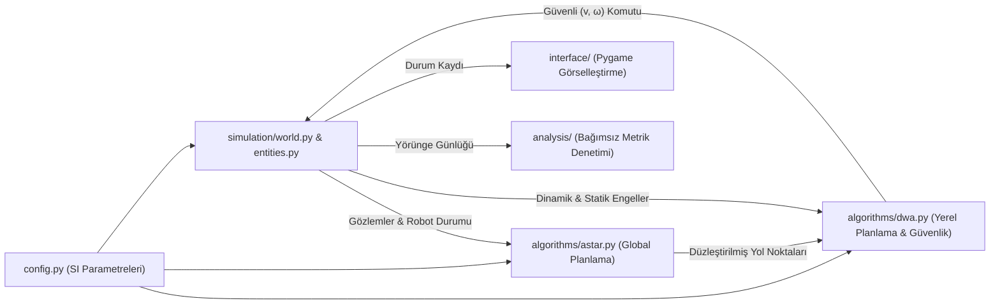

# DYNAMIC-NAV: Dinamik Engellerden Kaçınan Mobil Robot Simülasyon Sistemi

**Bölüm:** Elektrik-Elektronik Mühendisliği  
**Üniversite:** [Üniversite Adı Giriniz]  
**Danışman:** [Danışman Unvanı ve Adı Giriniz]  
**Proje Ekibi:** Eren Çakmaz, Ahmet Gürlek, Arda Başaran  
**Teslim Tarihi:** [GG.AA.YYYY]  

---

## ÖZET

Otonom mobil robotların dinamik, dar ve kısmen öngörülemez ortamlarda güvenli biçimde gezinmesi; algılama belirsizliği, kinematik kısıtlar ve gerçek zamanlı hesaplama bütçesi nedeniyle kritik bir mühendislik problemidir. Bu çalışmada, iki boyutlu sürekli uzayda diferansiyel sürüşlü (differential-drive) bir mobil robotun statik ve hareketli engellerden çarpışmasız kaçınmasını sağlayan **DYNAMIC-NAV** simülasyon ve navigasyon sistemi tasarlanmış ve doğrulanmıştır. Sistem; katı Uluslararası Birimler Sistemi (SI) disiplini üzerine kurulu deterministik bir fizik çekirdeği, Öklid engel şişirmeli 8-yönlü A\* global yol planlayıcısı (`algorithms/astar.py`) ve sürekli süpürme açıklığı (continuous swept-clearance) doğrulamalı Dinamik Pencere Yaklaşımı (Dynamic Window Approach — DWA) yerel planlayıcısını (`algorithms/dwa.py`) bir araya getirmektedir.

Yerel planlayıcı; aktif frenleme duruş mesafesi kontrolü, bekleme ufku doğrulaması, öncelikli geri çekilme (fallback) hiyerarşisi ve dar geçit ile açık alan sollamalarını yöneten proaktif geçit yönetimini tek bir deterministik kontrol döngüsünde birleştirmektedir. Sistem, 8 temel dinamik engel senaryosu ve 14 zorlu `NARROW-GATE` Seviye 1 varyantı (toplam 42 tekrarlı koşum) üzerinde bağımsız sürekli-zamanlı süpürme açıklığı denetçisiyle test edilmiştir. Faz 6.5.6 doğrulama sonuçlarına göre `191/191` otomatik `pytest` testi (`175,52 s`) başarıyla geçmiş; 8 temel senaryonun tamamında (`min_swept = 0,152024 m`) ve 42 `NARROW-GATE` koşumunun tamamında (`min_swept = 0,150019 m`) sıfır çarpışma, sıfır güvenlik payı ihlali (`>= 0,1500 m`) ve `%100` fiziksel determinizm elde edilmiştir.

**Anahtar Kelimeler:** Mobil Robot Navigasyonu, Dinamik Engel Kaçınması, A\* Yol Planlama, Dinamik Pencere Yaklaşımı (DWA), Sürekli Süpürme Açıklığı, Deterministik Simülasyon.

---

## 1. GİRİŞ

Otonom mobil robotlar; depo lojistiği, hastane içi taşıma ve servis robotiği gibi uygulamalarda yalnızca statik haritalara değil, ani durabilen, yön değiştirebilen veya dar geçitlerden karşı yönden yaklaşabilen dinamik engellere karşı da güvenli hareket etmek zorundadır. Klasik ızgara tabanlı global planlayıcılar statik çevre için en kısa yolu üretebilse de robotun ivme/hız sınırlarını ve hareketli engellerin anlık yörüngelerini hesaba katmaz. Buna karşılık yalnızca yerel reaktif yöntemlere dayanmak, dar koridorlarda veya uzun engellerin arkasında yerel minimuma takılma ya da güvenlik payı ihlali riskini doğurur.

Bu problemi çözmek amacıyla geliştirilen **DYNAMIC-NAV** projesi; global yol planlama ile kinematik olarak uygulanabilir yerel yörünge seçimini hiyerarşik bir mimaride birleştirirken, fiziksel simülasyon ile görselleştirme katmanını birbirinden tamamen ayırır. Sistemin temel tasarım hedefleri şunlardır: (i) tüm algoritma ve simülasyon katmanlarında yalnızca SI birimlerinin kullanılması, (ii) sürekli zamanlı süpürme açıklığı kontrolü ile `0,15 m` güvenlik payının (safety margin) ayrık örnekleme hatalarına karşı korunması, (iii) dar geçitlerde güvenli bekleme ve açık alanda proaktif sollama davranışlarının deterministik biçimde sağlanması.

---

## 2. SİSTEM MİMARİSİ

DYNAMIC-NAV, sorumlulukların katı biçimde ayrıldığı dört temel katmandan oluşmaktadır:

1. **Merkezi Konfigürasyon (`config.py`):** Tüm dünya, robot, planlayıcı ve deney parametrelerinin tek doğruluk kaynağıdır (single source of truth). Sabit kodlanmış (hardcoded) sihirli sayılar yerine `WorldConfig`, `RobotConfig`, `DWAConfig` ve `ExperimentConfig` veri sınıfları kullanılır.
2. **Simülasyon Çekirdeği (`simulation/`):** `simulation/entities.py`, `simulation/world.py` ve `simulation/scenarios.py` modüllerinden oluşur. `pygame` kütüphanesini hiçbir şekilde içe aktarmaz; dairesel robot kinematiğini, eksen-hizalı dikdörtgen (AABB) statik engelleri ve dinamik engelleri `dt_s = 0,05 s` zaman adımıyla ilerletir.
3. **Planlama Algoritmaları (`algorithms/`):** `algorithms/astar.py` 8-yönlü A\* global yolunu üretir ve çizgi-parçası tabanlı düzleştirme uygular; `algorithms/dwa.py` ise dinamik hız penceresini örnekler, frenleme ve süpürme açıklığı doğrulamasını yapar ve geri çekilme (fallback) kararlarını yönetir.
4. **Arayüz ve Analiz (`interface/`, `analysis/`):** `interface/` Pygame tabanlı görselleştirme ve kullanıcı etkileşimini sağlar; `analysis/` ise simülasyonlardan bağımsız olarak sürekli süpürme açıklığı (`compute_swept_clearance_m`), gecikme ve determinizm metriklerini hesaplar.

**Şekil 1.** DYNAMIC-NAV sistem mimarisi ve modüller arası veri akışı.

---

## 3. MATEMATİKSEL MODEL VE KULLANILAN ALGORİTMALAR

### 3.1. Robotun Diferansiyel Sürüş Kinematik Modeli

Robot, yarıçapı $r_R = 0,35\ \text{m}$ olan dairesel bir gövde olarak modellenmiştir (`RobotConfig.radius_m`). Durum vektörü $\mathbf{q} = [x, y, \theta]^T$ (konum ve yönelim radyan cinsinden), kontrol girdisi ise doğrusal hız $v \in [-0,6,\ 3,0]\ \text{m/s}$ ve açısal hız $\omega \in [-2,8,\ 2,8]\ \text{rad/s}$ şeklindedir. `simulation/entities.py` içerisindeki `Robot.step` metodu, ayrıklaştırma hatasını azaltmak için orta nokta yönelim integrasyonu (midpoint heading integration) uygular:

$$\theta_{k+1} = \mathrm{wrap}(\theta_k + \omega_k \Delta t), \qquad \theta_{\mathrm{mid}} = \theta_k + \frac{1}{2}\omega_k \Delta t$$

$$x_{k+1} = x_k + v_k \cos(\theta_{\mathrm{mid}})\Delta t, \qquad y_{k+1} = y_k + v_k \sin(\theta_{\mathrm{mid}})\Delta t$$

Burada $\Delta t = 0,05\ \text{s}$ (`ExperimentConfig.dt_s`) simülasyon zaman adımıdır ve $\mathrm{wrap}(\cdot)$ açıyı $[-\pi, \pi]$ aralığına indirger.

### 3.2. Küresel Yol Planlama (8-Yönlü A\*)

`algorithms/astar.py`, $20,0\ \text{m} \times 15,0\ \text{m}$ boyutlarındaki dünyayı $h = 0,2\ \text{m}$ çözünürlüklü bir doluluk ızgarasına böler (`WorldConfig`). Statik engeller robot yarıçapı ve güvenlik payı toplamı kadar ($r_R + d_{\mathrm{safe}} = 0,35 + 0,15 = 0,50\ \text{m}$) kesin Öklid hücre-merkezi mesafesiyle şişirilir:

$$d_{\min} = \sqrt{\max\left(0,\ |\Delta r|h - \frac{h}{2}\right)^2 + \max\left(0,\ |\Delta c|h - \frac{h}{2}\right)^2} < r_R + d_{\mathrm{safe}}$$

Arama sırasında ortogonal geçiş maliyeti $1,0$, çapraz geçiş maliyeti $\sqrt{2}$ olarak tanımlanır ve 8-yönlü hareket için kabul edilebilir (admissible) **oktil sezgisel fonksiyonu** (`octile_heuristic_m`) kullanılır:

$$h_{\mathrm{oct}}(\Delta r, \Delta c) = \left(\max(|\Delta r|, |\Delta c|) + (\sqrt{2} - 1)\min(|\Delta r|, |\Delta c|)\right) \cdot h$$

Bulunan ızgara yolu, `is_segment_collision_free` ve `segment_to_square_distance_m` yardımıyla gereksiz ara düğümlerden arındırılarak düzleştirilir.

### 3.3. Yerel Yol Planlama (Dinamik Pencere Yaklaşımı — DWA)

`algorithms/dwa.py`, kontrol döngüsünde robotun anlık $(v, \omega)$ değerinden ivme sınırları ($a_{\mathrm{lin}} = 5,0\ \text{m/s}^2$, $a_{\mathrm{ang}} = 16,0\ \text{rad/s}^2$) içinde ulaşabileceği dinamik hız penceresini hesaplar (`compute_dynamic_window`):

$$V_d = \left[\max(v_{\mathrm{bound}}, v - a_{\mathrm{lin}}\Delta t),\ \min(v_{\max}, v + a_{\mathrm{lin}}\Delta t)\right] \times \left[\max(-\omega_{\max}, \omega - a_{\mathrm{ang}}\Delta t),\ \min(\omega_{\max}, \omega + a_{\mathrm{ang}}\Delta t)\right]$$

Bu pencere $7 \times 17 = 119$ aday $(v, \omega)$ çiftine örneklenir (`linear_samples = 7`, `angular_samples = 17`) ve her aday $T_p = 1,2\ \text{s}$ ufuk boyunca $\Delta t_p = 0,1\ \text{s}$ adımlarla ileri benzetilir. Kabul edilebilir aday yörüngeler `score_trajectory` fonksiyonuyla puanlanır:

$$J(v, \omega) = w_h S_{\mathrm{head}} + w_c S_{\mathrm{clear}} + w_v S_{\mathrm{vel}} + w_p S_{\mathrm{path}} + S_{\mathrm{prog}} + P_{\mathrm{standstill}}$$

Burada $w_h = 1,3$, $w_c = 0,8$, $w_v = 1,8$, $w_p = 1,0$ (`DWAConfig`) ağırlıklardır. Terimler sırasıyla yönelim uyumunu ($1 - |\mathrm{wrap}(\theta_{\mathrm{des}} - \theta_{\mathrm{end}})|/\pi$), üst sınırı $0,65\ \text{m}$ olan açıklık puanını, normalize doğrusal hızı ($v / v_{\max}$), global yola yakınlığı ($1 - \min(1, d_{\mathrm{path}} / 2,0)$), hedefe ilerleme puanını ($[-1, 1]$ aralığına sıkıştırılmış) ve hedefe $0,35\ \text{m}$'den uzakken $v < 0,15\ \text{m/s}$ kalma durumunda uygulanan $-1,0$ durağanlık cezasını temsil eder.

### 3.4. Güvenlik Doğrulaması ve Sürekli Süpürme Açıklığı

Her aday yörünge yalnızca ayrık zaman noktalarında değil, ardışık durumlar arasındaki sürekli hareket süpürmesi (continuous swept clearance) boyunca da doğrulanır. Robotun tepki süresi $t_{\mathrm{react}} = 0,10\ \text{s}$ ve frenleme ivmesi $a_{\mathrm{brake}} = 5,0\ \text{m/s}^2$ için duruş mesafesi (`compute_stopping_distance_m`):

$$d_{\mathrm{stop}}(v) = |v| \cdot t_{\mathrm{react}} + \frac{v^2}{2 a_{\mathrm{brake}}}$$

Faz 6.5.5.7 düzeltmesiyle DWA içindeki statik AABB süpürme açıklığı hesabı, bağımsız değerlendirici `analysis/metrics.py::compute_swept_clearance_m()` ile geometrik olarak birebir hizalanmış ve tüm senaryolarda minimum $d_{\mathrm{safe}} = 0,15\ \text{m}$ açıklık garanti altına alınmıştır.

### 3.5. Hiyerarşik Geri Çekilme (Fallback) ve Geçit Yönetimi

Aday yörüngelerin hiçbiri güvenli bulunmadığında sistem rastgele durmak yerine kademeli bir geri çekilme hiyerarşisi uygular: (i) dinamik ve statik engellere karşı $T_w = 2,5\ \text{s}$ (`waiting_horizon_s`) bekleme ufku boyunca güvenli duruş pozisyonunu doğrulayan güvenli duruş frenlemesi (`SAFE_STANDSTILL_BRAKING`), (ii) acil kaçınma manevraları. Ayrıca `CorridorPassingManager`, dar geçitlerde güvenli bekleme noktası seçimini ve açık alanlarda yavaş ilerleyen ön engellere karşı proaktif yanal sollamayı (`proactive_hysteresis_steps = 3`, `proactive_open_space_hysteresis_steps = 8`, `proactive_replan_cooldown_s = 2,5 s`) yönetir.

---

## 4. DİNAMİK ENGEL SENARYOLARI

Sistemin başarımı, `simulation/scenarios.py` içerisinde tanımlanan ve farklı fiziksel etkileşim rejimlerini sınayan 8 temel senaryo üzerinde değerlendirilmiştir:

| Senaryo Adı | Test Edilen Fiziksel Durum ve Zorluk |
|---|---|
| `HEAD-ON` | Robot ile karşı yönden doğrudan yaklaşan dinamik engelin kafa kafaya karşılaşması ve yanal kaçınma. |
| `CROSSING` | Robotun rotasını dik veya eğik açıyla kesen hareketli engele karşı hız ayarlama ve geçiş zamanlaması. |
| `CORRIDOR` | Dar duvarlar arasında ilerleyen robotun hem statik duvar payını koruyup hem de engel ile çarpışmaması. |
| `STOP-AND-GO` | Dur-kalk hareketi yapan engelin arkasında güvenli takip mesafesi ve ani hız değişimlerine tepki. |
| `NARROW-GATE` | Dar bir geçit açıklığında karşıdan veya aynı yönden gelen engellerle geçiş önceliği ve bekleme yönetimi. |
| `MULTIPLE-DYNAMIC-OBSTACLES` | Aynı anda birden fazla hareketli engelin bulunduğu karmaşık ortamda çoklu çarpışma önleme. |
| `SUDDEN-STOP` | Öndeki engelin aniden durması durumunda tepki süresi ve frenleme mesafesi yeterliliği. |
| `SUDDEN-STOP-FINITE-DECEL` | Sonlu yavaşlama ivmesiyle duran engele karşı hız tahmini ve güvenlik payının korunması. |

**Tablo 1.** DYNAMIC-NAV temel doğrulama senaryoları ve test ettikleri etkileşim türleri.

---

## 5. DENEYSEL YÖNTEM

Deneysel doğrulama, **Faz 6.5.6 — Nihai Sistem Bütünlüğü ve Regresyon Denetimi** kapsamında salt-okunur (read-only) biçimde yürütülmüştür. Değerlendirme üç katmandan oluşmaktadır: (1) tüm birim, kinematik, planlayıcı ve regresyon testlerini kapsayan `pytest` test süiti (`191` test), (2) 8 temel senaryonun tam simülasyon koşumu ve (3) dar geçit, ani hız/yön değişimi ile algılama gürültüsünü içeren `14` adet `NARROW-GATE` Seviye 1 varyantının her birinin 3 bağımsız tekrar ile (toplam `42` koşum) determinizm ve güvenlik denetimi. Çarpışma ve güvenlik payı ihlalleri, DWA'dan tamamen bağımsız olan `analysis/metrics.py` modülü tarafından sürekli süpürme açıklığı ile ölçülmüştür.

---

## 6. DENEYSEL BULGULAR VE TARTIŞMA

### 6.1. Test Süiti ve Temel Senaryo Sonuçları

Otomatik test süitinde `191/191` test (`0` hata, `0` atlanan test) toplam `175,52 s` sürede başarıyla geçmiştir. 8 temel senaryonun tamamı `GOAL_REACHED` durumuyla sonlanmış; hiçbir fiziksel çarpışma veya `0,1500 m` güvenlik payı ihlali gözlenmemiştir.

| Temel Senaryo | Sonuç | Min. Süpürme Açıklığı (m) | Ort. DWA Süresi (ms) |
|---|---|---|---|
| `HEAD-ON` | `GOAL_REACHED` | `0,257926` | `7,273` |
| `CROSSING` | `GOAL_REACHED` | `0,152699` | `7,251` |
| `CORRIDOR` | `GOAL_REACHED` | `0,155123` | `3,437` |
| `STOP-AND-GO` | `GOAL_REACHED` | `0,152024` | `6,428` |
| `NARROW-GATE` | `GOAL_REACHED` | `0,154363` | `44,470` |
| `MULTIPLE-DYNAMIC-OBSTACLES` | `GOAL_REACHED` | `0,152792` | `8,608` |
| `SUDDEN-STOP` | `GOAL_REACHED` | `0,298483` | `6,448` |
| `SUDDEN-STOP-FINITE-DECEL` | `GOAL_REACHED` | `0,153625` | `10,915` |

**Tablo 2.** Faz 6.5.6 temel senaryo sonuçları (ortalama DWA süresi ortalaması `11,85 ms`, ortalama P95 `36,98 ms`, maksimum `246,88 ms`).

### 6.2. NARROW-GATE Seviye 1 Varyantları ve Determinizm

Zorlayıcı `14` adet `NARROW-GATE` Seviye 1 varyantı üzerinde gerçekleştirilen `42` koşumun tamamı `GOAL_REACHED` ile tamamlanmıştır:
- **Fiziksel Çarpışma / Pay İhlali:** `0` çarpışma, `0` güvenlik payı ihlali. En kritik varyant olan `NARROW-GATE__L1-DO-01__01` koşumunda ölçülen minimum süpürme açıklığı `0,150019 m` olup `0,1500 m` sınırının üzerindedir (Faz 6.5.5.7 öncesi `0,149811 m` düzeyindeki ayrıklaştırma farkı tamamen giderilmiştir).
- **Fiziksel Determinizm:** Her varyantın 3 tekrarlı koşumunda `%100` birebir determinizm doğrulanmıştır.
- **Hesaplama Gecikmesi (Latency):** `42` koşumda yapılan `19.014` DWA çağrısında medyan süre `5,58 ms` olarak ölçülmüştür; ancak yoğun dar geçit etkileşimlerinde bekleme ufku ve sürekli süpürme kontrolleri nedeniyle P99 gecikmesi `232,48 ms`'ye çıkmakta ve çağrıların `3.280 / 19.014` (`%17,25`) kadarı `50 ms` kontrol adımını aşmaktadır.

---

## 7. SİSTEMİN SINIRLILIKLARI VE GELECEK ÇALIŞMALAR

1. **Gerçek Zamanlı Gecikme Kuyruğu:** Medyan DWA süresi (`5,58 ms`) `50 ms` simülasyon adımının oldukça altında olsa da, karmaşık `NARROW-GATE` anlarında çağrıların `%17,25`'i `50 ms`'yi aşmaktadır. Gelecek çalışmalarda uzamsal indeksleme (spatial hashing) ve aday yörüngelerin erken budanması (early pruning) ile P99 gecikmesi düşürülebilir.
2. **İki Boyutlu Dairesel Robot Kabulu:** Mevcut model dairesel robot geometrisi ve düzlemsel kinematik üzerine kuruludur; dikdörtgen gövdeli veya holonomik olmayan farklı platformlar için çoklu daire yaklaşımı eklenebilir.
3. **Sabit Hızlı Engel Ekstrapolasyonu:** Yerel planlayıcı dinamik engellerin gelecek konumlarını kısa ufukta sabit hız varsayımı ve belirsizlik payı ile kestirmektedir; niyet tahmini (intent prediction) entegrasyonu manevra yumuşaklığını artırabilir.

---

## 8. SONUÇ

DYNAMIC-NAV projesi; temiz SI birim mimarisi, orta nokta kinematiği, Öklid şişirmeli A\* global planlayıcısı ve sürekli süpürme açıklığı doğrulamalı DWA yerel planlayıcısı ile dinamik ortamlarda güvenli otonom navigasyon için tutarlı ve doğrulanabilir bir mühendislik çözümü sunmaktadır. Faz 6.5.6 denetimiyle `191/191` test, `8/8` temel senaryo ve `42/42` `NARROW-GATE` Seviye 1 koşumu sıfır çarpışma, sıfır güvenlik payı ihlali ve `%100` determinizm ile tamamlanarak sistem teslim düzeyine ulaştırılmıştır.

---

## PROJE EKİBİ VE GÖREV DAĞILIMI

Bu çalışma **Eren Çakmaz**, **Ahmet Gürlek** ve **Arda Başaran** tarafından ortak mühendislik çalışması olarak geliştirilmiştir. Her üç ekip üyesi de yazılım geliştirme, testlerin yürütülmesi, hata ayıklama ve deneysel doğrulama süreçlerinin tamamına ortak katkı sağlamıştır. Aşağıdaki tablo **önerilen sorumluluk paylaşımını** özetlemektedir:

| Ekip Üyesi | Önerilen Odak Alanı | Temel Modüller ve Katkılar |
|---|---|---|
| **Eren Çakmaz** | Simülasyon Çekirdeği, Kinematik ve Global Planlama | `config.py`, `simulation/entities.py`, `simulation/world.py`, `algorithms/astar.py` (SI mimarisi, orta nokta integrasyonu, 8-yönlü A\* ve oktil sezgisel) |
| **Ahmet Gürlek** | Yerel Planlama (DWA), Güvenlik ve Arayüz | `algorithms/dwa.py`, `simulation/scenarios.py`, `interface/` (dinamik pencere, süpürme açıklığı, geri çekilme yönetimi ve 8 senaryo) |
| **Arda Başaran** | Test, Deneysel Analiz ve Dokümantasyon | `analysis/`, `tests/`, `README.md`, Faz 6.5.6–7.1 raporları (`191` pytest testi, 42 `NARROW-GATE` kıyaslaması, Türkçe akademik rapor) |

---

## KAYNAKÇA

1. Hart, P. E., Nilsson, N. J., & Raphael, B. (1968). A Formal Basis for the Heuristic Determination of Minimum Cost Paths. *IEEE Transactions on Systems Science and Cybernetics*, 4(2), 100–107.
2. Fox, D., Burgard, W., & Thrun, S. (1997). The Dynamic Window Approach to Collision Avoidance. *IEEE Robotics & Automation Magazine*, 4(1), 23–33.
3. Siegwart, R., Nourbakhsh, I. R., & Scaramuzza, D. (2011). *Introduction to Autonomous Mobile Robots* (2nd ed.). MIT Press.
4. DYNAMIC-NAV Proje Deposu: `config.py`, `simulation/entities.py`, `algorithms/astar.py`, `algorithms/dwa.py`, `analysis/metrics.py`, `README.md` ve `analysis/results/phase656_final_audit_report.md`.
