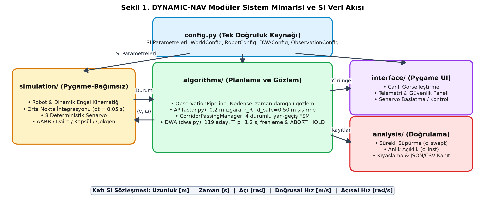
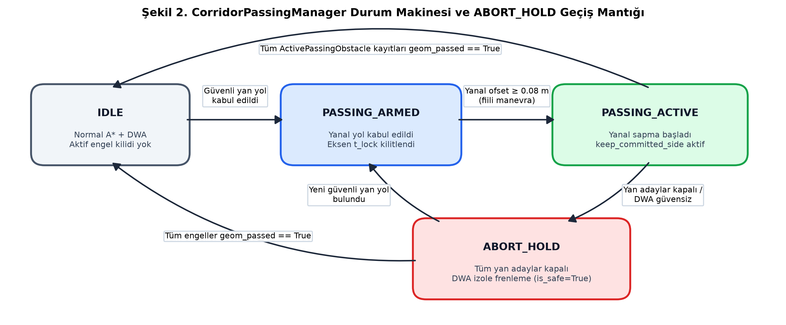
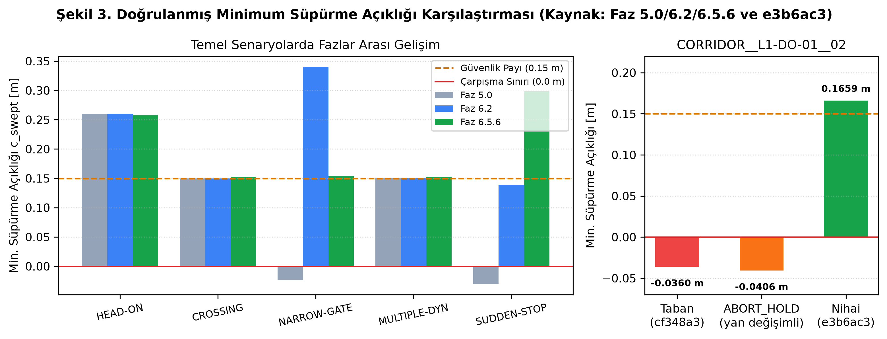
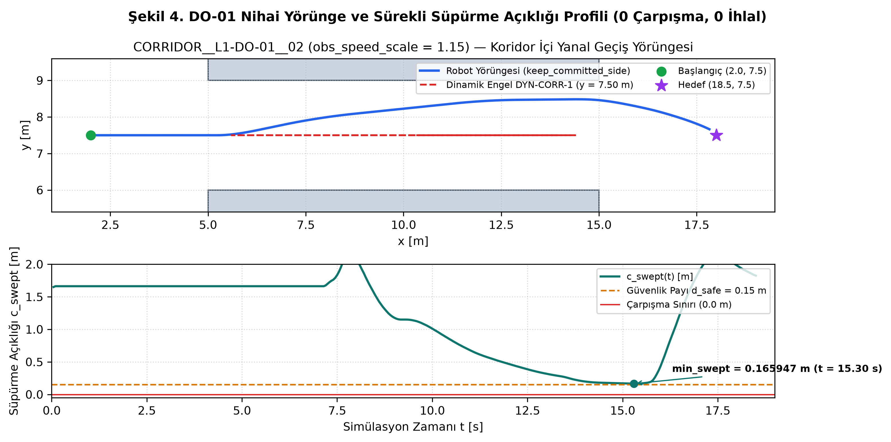
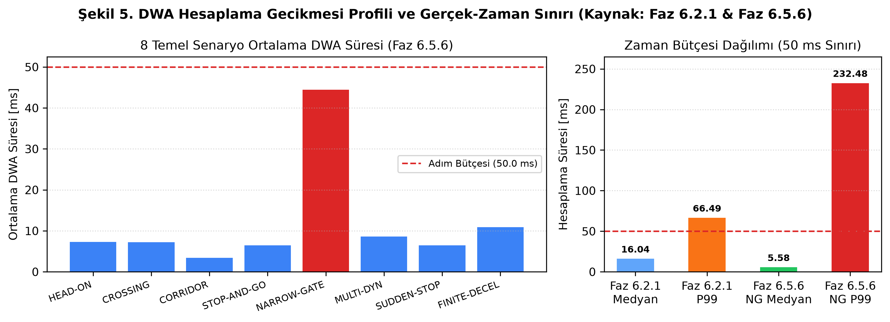

# DYNAMIC-NAV: Dinamik Engellerden Kaçınan Mobil Robot Simülasyon Sistemi

**Kurum:** Sakarya Uygulamalı Bilimler Üniversitesi — Elektrik-Elektronik Mühendisliği  
**Proje Ekibi:** Eren Çakmaz, Ahmet Gürlek, Arda Başaran  
**Danışman:** Doç. Dr. Ali Furkan Kamanlı  
**Teslim Tarihi:** 24 Kasım 2026

---

## Türkçe Özet

Otonom mobil robotların dinamik, dar ve kısmen öngörülemez ortamlarda güvenli biçimde gezinmesi; algılama kısıtları, kinematik sınırlar ve hesaplama zaman bütçesi nedeniyle önemli bir mühendislik problemidir. Bu çalışmada, iki boyutlu sürekli uzayda diferansiyel sürüşlü bir mobil robotun statik ve hareketli engellerden çarpışmasız kaçınmasını sağlayan **DYNAMIC-NAV** simülasyon ve navigasyon sistemi tasarlanmış, iyileştirilmiş ve doğrulanmıştır. Sistem; katı Uluslararası Birimler Sistemi (SI) disiplinine sahip deterministik bir fizik çekirdeği (`simulation/`), kesin Öklid engel şişirmeli 8-yönlü A\* küresel yol planlayıcısı (`algorithms/astar.py`), proaktif yan-geçiş durum makinesi (`algorithms/corridor_passing.py`), nedensel gözlem hattı (`algorithms/observation.py`) ve sürekli süpürme açıklığı doğrulamalı Dinamik Pencere Yaklaşımı (DWA) yerel planlayıcısını (`algorithms/dwa.py`) bütünleştirmektedir.

Algoritma geliştirme süreci Faz 5.0 (`ASTAR_DWA` `3/5` başarı, `2` çarpışma) ve Faz 6.2 (`6/6` başarı, `0` çarpışma, `SUDDEN-STOP`'ta `0,1390 m` güvenlik payı ihlali) üzerinden Faz 6.5.5 (`120` varyant, `360` koşum, `%85,0` başlangıç başarısı) dayanıklılık taramasıyla ilerletilmiştir. Faz 6.5.6 tarihsel doğrulamasında `191/191` `pytest` testi (`175,52 s`), `8/8` temel senaryo (`min_swept = 0,152024 m`) ve `14/14` `NARROW-GATE` Seviye 1 varyantı (`42` koşum, `min_swept = 0,150019 m`, `%100` determinizm) sıfır çarpışma ve sıfır güvenlik payı ihlaliyle (`>= 0,150000 m`) tamamlanmıştır. Faz 8.0 sertleştirmesiyle `CorridorPassingManager` durum makinesi (`PASSING_ARMED`, `PASSING_ACTIVE`, `ABORT_HOLD`, `keep_committed_side`) ve `DWAPlanner` frenleme koruması eklenmiş; bu raporda kaydedilen tarihsel yerel ve GitHub Actions koşularında **`202/202`** test geçmiştir. Bu incelemede, mevcut çalışma kopyasında `python -m pytest -v` komutuyla **`206/206`** testin `225,85 s` içinde geçtiği ayrıca gözlenmiştir. Bu yeni yerel koşu, tarihsel CI sonucunu değiştirmez. `CORRIDOR__L1-DO-01__02` senaryosunun tarihsel sonucu `0` çarpışma, `0` güvenlik payı ihlali ve `min_swept = 0,165947 m`'dir. Gerçek-zaman garantisi ve fiziksel robot donanım testi iddia edilmemektedir.

**Anahtar Kelimeler:** Mobil Robot Navigasyonu, Dinamik Engel Kaçınması, A\* Yol Planlama, Dinamik Pencere Yaklaşımı (DWA), Sürekli Süpürme Açıklığı, Deterministik Simülasyon.

---

## 1. Giriş

Otonom mobil robotlar; depo lojistiği, endüstriyel taşıma ve servis robotiği gibi uygulamalarda statik haritaların yanı sıra ani durabilen, yön değiştirebilen veya dar geçitlerden karşı yönden yaklaşabilen dinamik engellere karşı da güvenli hareket etmek zorundadır. Yalnızca küresel ızgara planlayıcılar statik çevre için kısa yollar üretse de hız/ivme sınırlarını ve hareketli engelleri dikkate almaz; yalnızca yerel reaktif yöntemler ise dar koridorlarda yerel minimuma takılma riski taşır. **DYNAMIC-NAV**, küresel planlama ile kinematik olarak uygulanabilir yerel kaçınmayı hiyerarşik bir mimaride birleştirirken, fiziksel simülasyonu görselleştirme arayüzünden tamamen izole eder.

## 2. Problem Tanımı ve Proje Amacı

İki boyutlu sınırlı bir çalışma uzayı $\mathcal{W} = [0, W] \times [0, H] \subset \mathbb{R}^2$ ($W = 20,0\ \text{m}$, $H = 15,0\ \text{m}$) içinde yarıçapı $r_R = 0,35\ \text{m}$ olan dairesel bir mobil robot ele alınmaktadır. Ortamda eksen-hizalı dikdörtgen (AABB) statik engeller ve hareketli dairesel/geometrik dinamik engeller bulunmaktadır. Amaç; robotun başlangıç konumundan hedef konumuna $\epsilon_g = 0,25\ \text{m}$ tolerans içinde ulaşmasını sağlarken tüm simülasyon boyunca fiziksel çarpışmasızlık **(1a)**, minimum güvenlik payı korunumu **(1a)**, hedefe ulaşma **(1b)** ve gizli gelecek zamanlayıcılarına erişmeden nedensel gözlem ilkesinin sağlanmasıdır:

$$c_{\mathrm{swept}}(t) > 0\ \text{m}, \qquad c_{\mathrm{swept}}(t) \ge d_{\mathrm{safe}} = 0,15\ \text{m}$$

**(1a)** Fiziksel çarpışmasızlık ve minimum güvenlik payı koşulları.

$$\|\mathbf{p}(t_f) - \mathbf{p}_{\mathrm{goal}}\|_2 \le \epsilon_g = 0,25\ \text{m}$$

**(1b)** Hedefe ulaşma koşulu.

## 3. Sistem Mimarisi

DYNAMIC-NAV dört modüler katmandan oluşmaktadır (**Şekil 1**):
1. **`config.py`**: Tüm SI parametrelerinin (`WorldConfig`, `RobotConfig`, `DWAConfig`, `ObservationConfig`, `ExperimentConfig`) tek doğruluk kaynağı.
2. **`simulation/`**: `pygame` bağımsızlığı bulunmayan deterministik fizik çekirdeği (`entities.py`, `world.py`, `geometry.py`, `scenarios.py`).
3. **`algorithms/`**: 8-yönlü A\* küresel planlayıcı (`astar.py`), DWA yerel planlayıcı (`dwa.py`), proaktif koridor geçiş durum makinesi (`corridor_passing.py`), nedensel gözlem hattı (`observation.py`) ve saf izleyici (`path_follower.py`).
4. **`interface/` ve `analysis/`**: Pygame görselleştirme arayüzü (`interface/`) ile bağımsız sürekli süpürme açıklığı ve kıyaslama denetçisi (`analysis/metrics.py`, `analysis/benchmark.py`).

## 4. Matematiksel Model ve Algoritmalar

### 4.1. Robot Kinematiği ve Orta Nokta İntegrasyonu

Diferansiyel sürüşlü robotun sürekli zamanlı hareket modeli (`simulation/entities.py::Robot.step`) denklem **(2)** ile tanımlanır:

$$\dot{x}(t) = v(t)\cos\theta(t), \qquad \dot{y}(t) = v(t)\sin\theta(t), \qquad \dot{\theta}(t) = \omega(t)$$

**(2)** Diferansiyel sürüşlü mobil robot kinematik denklemleri.

Burada $(x, y)$ konum ($\text{m}$), $\theta \in [-\pi, \pi]$ yönelim ($\text{rad}$), $v \in [-0,6,\ 3,0]\ \text{m/s}$ doğrusal hız ve $\omega \in [-2,8,\ 2,8]\ \text{rad/s}$ açısal hızdır. Ayrık adım $\Delta t = 0,05\ \text{s}$ (`ExperimentConfig.dt_s`) üzerinde yönelim gecikmesini azaltmak için **orta nokta yönelim integrasyonu** uygulanır **(3)–(4)**:

$$\theta_{k+1} = \mathrm{wrap}(\theta_k + \omega_k \Delta t), \qquad \theta_{\mathrm{mid}} = \theta_k + \frac{1}{2}\omega_k \Delta t$$

**(3)** Ayrık yönelim güncellemesi ve orta nokta açısı.

$$x_{k+1} = x_k + v_k \cos(\theta_{\mathrm{mid}})\Delta t, \qquad y_{k+1} = y_k + v_k \sin(\theta_{\mathrm{mid}})\Delta t$$

**(4)** Orta nokta integrasyonu ile konum güncellemesi.

### 4.2. Küresel Yol Planlama — A\*

`algorithms/astar.py`, dünyayı $h = 0,2\ \text{m}$ çözünürlüklü $100 \times 75$ doluluk ızgarasına böler. Statik engeller, robot yarıçapı ve güvenlik payı toplamı ($r_R + d_{\mathrm{safe}} = 0,50\ \text{m}$) kadar kesin Öklid hücre-merkezi mesafesiyle şişirilir (`inflate_occupancy_grid`) **(5)**:

$$d_{\min}(\Delta r, \Delta c) = \sqrt{\max\!\left(0,\ |\Delta r|h - \frac{h}{2}\right)^2 + \max\!\left(0,\ |\Delta c|h - \frac{h}{2}\right)^2} < r_R + d_{\mathrm{safe}}$$

**(5)** Kesin Öklid engel şişirme koşulu.

Arama sırasında toplam maliyet $f(n) = g(n) + h_{\mathrm{oct}}(n)$ ve 8-yönlü kabul edilebilir **oktil sezgisel fonksiyonu** (`octile_heuristic_m`) kullanılır (ortogonal geçiş $1,0$, çapraz geçiş $\sqrt{2}$) **(6)**:

$$h_{\mathrm{oct}}(\Delta r, \Delta c) = \left(\max(|\Delta r|, |\Delta c|) + (\sqrt{2} - 1)\min(|\Delta r|, |\Delta c|)\right) \cdot h$$

**(6)** 8-yönlü oktil sezgisel mesafe fonksiyonu.

Bulunan yol `is_segment_collision_free` ile düzleştirilir.

### 4.3. Yerel Dinamik Engel Kaçınması — DWA ve Nedensel Gözlem

`algorithms/observation.py` (`ObservationPipeline`), gizli senaryo zamanlayıcılarını dışarı sızdırmadan yalnızca zaman damgalı konum, hız ve doğrusal büyüyen belirsizlik zarfı ($r_{\mathrm{eff}}(t) = r_o + \sigma_0 + \dot{\sigma} t$) üretir. `algorithms/dwa.py`, anlık $(v, \omega)$ değerinden ivme sınırları ($a_{\mathrm{lin}} = 5,0\ \text{m/s}^2$, $a_{\mathrm{ang}} = 16,0\ \text{rad/s}^2$) içinde ulaşılabilen dinamik hız penceresini (`compute_dynamic_window`) hesaplar ve $7 \times 17 = 119$ aday çifte örnekler **(7)**:

$$V_d = \left[\max(v_{\mathrm{bound}},\, v - a_{\mathrm{lin}}\Delta t),\ \min(v_{\max},\, v + a_{\mathrm{lin}}\Delta t)\right]$$

$$\times \left[\max(-\omega_{\max},\, \omega - a_{\mathrm{ang}}\Delta t),\ \min(\omega_{\max},\, \omega + a_{\mathrm{ang}}\Delta t)\right]$$

**(7)** Dinamik hız penceresi sınırları.

Her aday $T_p = 1,2\ \text{s}$ ufukta $\Delta t_p = 0,1\ \text{s}$ adımlarla ileri benzetilir ve `score_trajectory` ile puanlanır ($w_h = 1,3$, $w_c = 0,8$, $w_v = 1,8$, $w_p = 1,0$) **(8)**:

$$J(v, \omega) = w_h S_{\mathrm{head}} + w_c S_{\mathrm{clear}} + w_v S_{\mathrm{vel}} + w_p S_{\mathrm{path}} + S_{\mathrm{prog}} + P_{\mathrm{standstill}}$$

**(8)** DWA çok kriterli yörünge puanlama fonksiyonu.

Tepki süresi $t_{\mathrm{react}} = 0,10\ \text{s}$ ve frenleme ivmesi $a_{\mathrm{brake}} = 5,0\ \text{m/s}^2$ için duruş mesafesi (`compute_stopping_distance_m`) ile doğrulanır **(9)**:

$$d_{\mathrm{stop}}(v) = |v|\, t_{\mathrm{react}} + \frac{v^2}{2 a_{\mathrm{brake}}}$$

**(9)** Tepki süresi dâhil fiziksel duruş mesafesi.

### 4.4. Proaktif Koridor Geçişi (`CorridorPassingManager`) ve `ABORT_HOLD`

`algorithms/corridor_passing.py`, dar koridor ve açık alan sollamalarını dört durumlu bir makineyle yönetir: `IDLE`, `PASSING_ARMED`, `PASSING_ACTIVE` ve `ABORT_HOLD` (**Şekil 2**). Geçiş başlangıcında eksen ($\hat{\mathbf{t}}_{\mathrm{lock}}$) kilitlenir ve tehdit oluşturan tüm dinamik engeller `ActivePassingObstacle` kümesinde izlenir. Dairesel, yönlendirilmiş dikdörtgen, kapsül ve çokgen geometriler için destek fonksiyonu projeksiyonuyla robotun arka kenarı tüm engelleri güvenlik payı ve tamamlama payıyla geride bırakmadan `IDLE` durumuna dönülmez. Aktif geçiş sırasında engel yön değiştirirse cooldown nedensel olarak aşılır; mevcut geçerli yan şerit (`keep_committed_side`) korunarak engel ekseninden karşıya erken geçiş engellenir. Tüm yan adaylar reddedildiğinde `ABORT_HOLD` tetiklenir ve `DWAPlanner` eski yolu puanlamayı durdurup sıfıra en yakın doğrulanmış (`is_safe=True`) hız büyümesiz frenleme komutunu seçer.

### 4.5. Çarpışma Kontrolü ve Güvenlik Açıklığı

`analysis/metrics.py`, tek zaman adımındaki **anlık açıklık** ($c_{\mathrm{inst}}$) ile ardışık adımlar arasındaki doğrusal süpürme boyunca hesaplanan **süpürülmüş açıklığı** ($c_{\mathrm{swept}}$) ayırır. Statik AABB engellere karşı `segment_to_square_distance_m`, hareketli engellere karşı `swept_circle_min_distance_m` kullanılır. Güvenlik sınırı $d_{\mathrm{safe}} = 0,150000\ \text{m}$'dir.

## 5. Deneysel Yöntem ve Test Ortamı

Değerlendirme, `Python 3.12.10` ve `pytest 9.2.0` ortamında `simulation/scenarios.py` içinde tanımlı 8 deterministik senaryo (`HEAD-ON`, `CROSSING`, `CORRIDOR`, `STOP-AND-GO`, `NARROW-GATE`, `MULTIPLE-DYNAMIC-OBSTACLES`, `SUDDEN-STOP`, `SUDDEN-STOP-FINITE-DECEL`) ve Seviye 1 dayanıklılık pertürbasyonları üzerinde yürütülmüştür. Ölçüm adımı $\Delta t = 0,05\ \text{s}$'dir.

## 6. Deneysel Sonuçlar

### 6.1. Algoritma Geliştirme Karşılaştırması (Faz 5.0 vs. Faz 6.2)

**Tablo 1**, aynı senaryo ve aynı ölçüm yöntemi altında Faz 5.0 ile Faz 6.2 arasındaki gelişimi göstermektedir. `ASTAR_FOLLOWER` tüm senaryolarda `COLLISION_ABORT` ile sonlanmıştır (`0/5` ve `0/6`). `ASTAR_DWA` ise Faz 5.0'da `3/5` başarı verirken Faz 6.2'de `6/6` `GOAL_REACHED` (`0` çarpışma) düzeyine çıkmış; ancak `SUDDEN-STOP` (`0,1390 m < 0,15 m`) ve `CROSSING` (`1` pay ihlali) durumlarında güvenlik payı ihlalleri sürmüştür.

| Senaryo | Faz 5.0 `ASTAR_DWA` (Sonuç / Çarp. / İhlal / Süp. m) | Faz 6.2 `ASTAR_DWA` (Sonuç / Çarp. / İhlal / Süp. m / Süre s / Yol m) |
|---|---|---|
| `HEAD-ON` | `GOAL_REACHED` / 0 / 0 / `0,2605` | `GOAL_REACHED` / 0 / 0 / `0,2605` / `15,60` / `23,95` |
| `CROSSING` | `GOAL_REACHED` / 0 / 1 / `0,1500` | `GOAL_REACHED` / 0 / 1 / `0,1500` / `13,80` / `19,28` |
| `NARROW-GATE` | `COLLISION_ABORT` / 1 / 1 / `-0,0232` | `GOAL_REACHED` / 0 / 0 / `0,3398` / `15,55` / `24,13` |
| `MULTIPLE-DYN` | `GOAL_REACHED` / 0 / 0 / `0,1502` | `GOAL_REACHED` / 0 / 0 / `0,1502` / `17,55` / `25,34` |
| `SUDDEN-STOP` | `COLLISION_ABORT` / 1 / 3 / `-0,0299` | `GOAL_REACHED` / 0 / 2 / `0,1390` / `23,45` / `23,41` |
| `FINITE-DECEL` | *(Faz 5.0 kapsamı dışı)* | `GOAL_REACHED` / 0 / 1 / `0,1500` / `18,95` / `22,54` |

### 6.2. Faz 6.5.5 Dayanıklılık Taraması ve Faz 6.5.6 Tarihsel Doğrulaması

Faz 6.5.5 Seviye 1 taramasında (`120` varyant, `360` koşum) başlangıç başarısı `%85,0` (`102/120`) olarak saptanmıştır. Zamanlayıcı, güvenli bekleme, açık alan sollaması ve statik AABB süpürme düzeltmelerinin ardından **Faz 6.5.6** tarihsel denetiminde `191/191` `pytest` testi (`175,52 s`) geçmiş; 8 temel senaryonun tamamı `0` çarpışma ve `0` ihlal ile `GOAL_REACHED` olmuştur (**Tablo 2**, **Şekil 3**).

| Temel Senaryo (Faz 6.5.6) | Sonuç | Min. Anlık Açıklık (m) | Min. Süpürme Açıklığı (m) | Ort. DWA (ms) |
|---|---|---|---|---|
| `HEAD-ON` | `GOAL_REACHED` | `0,258924` | `0,257926` | `7,273` |
| `CROSSING` | `GOAL_REACHED` | `0,153208` | `0,152699` | `7,251` |
| `CORRIDOR` | `GOAL_REACHED` | `0,155297` | `0,155123` | `3,437` |
| `STOP-AND-GO` | `GOAL_REACHED` | `0,153300` | `0,152024` | `6,428` |
| `NARROW-GATE` | `GOAL_REACHED` | `0,154440` | `0,154363` | `44,470` |
| `MULTIPLE-DYNAMIC-OBSTACLES` | `GOAL_REACHED` | `0,153590` | `0,152792` | `8,608` |
| `SUDDEN-STOP` | `GOAL_REACHED` | `0,298817` | `0,298483` | `6,448` |
| `SUDDEN-STOP-FINITE-DECEL` | `GOAL_REACHED` | `0,154328` | `0,153625` | `10,915` |

Faz 6.5.6 `NARROW-GATE` Seviye 1 dayanıklılık testlerinde (`14` varyant × `3` tekrar = `42` koşum) `14/14` başarı, `0` çarpışma, `0` pay ihlali, `%100` determinizm ve `0,150019 m` minimum süpürme açıklığı ölçülmüştür (`19.014` DWA çağrısında medyan `5,58 ms`, `P99 = 232,48 ms`).

### 6.3. Nihai Sertleştirme ve `DO-01` Doğrulaması (`main`)

Faz 8.0 kapsamında `CorridorPassingManager` durum makinesi (`PASSING_ARMED`, `PASSING_ACTIVE`, `ABORT_HOLD`, çoklu engel takibi, reversal cooldown aşımı, `keep_committed_side`) ve `DWAPlanner` izole `ABORT_HOLD` frenleme koruması uygulanmıştır. Güncel `main` dalında:
- **Tarihsel yerel tam test paketi (`python -m pytest -v`)**: **`202/202` PASSED** (`456,42 s`, `0` failed, `0` skipped).
- **Tarihsel GitHub Actions CI (`Pytest (Python 3.12)`)**: **`202/202` PASSED** (`190,96 s`, `0` failed, `0` skipped).
- **Bu incelemede mevcut çalışma kopyasında çalıştırılan yerel paket**: **`206/206` PASSED** (`225,85 s`, `0` failed, `0` skipped).
- **`CORRIDOR__L1-DO-01__02` (`obs_speed_scale = 1,15`)**: Önceki `COLLISION_ABORT` (`-0,036039 m` / `-0,040569 m`) hatası `keep_committed_side` ile giderilmiş; **`goal_reached = True`**, **`0` çarpışma**, **`0` güvenlik payı ihlali**, **`min_swept_m = 0,165947 m`**, **`completion_time_s = 18,5 s`**, **`%100` determinizm** doğrulanmıştır (**Şekil 4**).

## 7. Tartışma ve Sınırlılıklar

1. **Gerçek Zamanlı Duvar Saati Performansı vs. Deterministik Adım:** Simülasyon sabit $\Delta t = 0,05\ \text{s}$ (`50 ms`) adımıyla deterministik çalışmaktadır; ancak duvar saati (wall-clock) hesaplama süresinde Faz 6.2.1'de `%3,2` (`90/2.821`), Faz 6.5.6 `NARROW-GATE` testlerinde ise `3.280/19.014` (`%17,25`) çağrı `50 ms` bütçesini aşmıştır (`P99 = 232,48 ms`, **Şekil 5**). Bu nedenle sert gerçek-zaman garantisi iddia edilmemektedir.
2. **Simülasyon Ortamı ve Geometri Kabulleri:** Tüm doğrulamalar 2B simülasyon ortamında yürütülmüştür; fiziksel robot donanımı veya saha deneyi gerçekleştirilmemiştir. Kısa ufuklu sabit hızlı engel kestirimi ve varsayılan sıfır-gürültü (`ObservationConfig`) kabulleri kullanılmaktadır.

## 8. Sonuç

DYNAMIC-NAV, Faz 5.0'daki çarpışmalardan Faz 6.5.6 tarihsel denetimine (`191/191`) ve ardından Faz 8.0 sertleştirme kayıtlarındaki `202/202` yerel/CI test başarısına ulaşmıştır. Mevcut çalışma kopyasında yapılan ek yerel doğrulamada `206/206` test geçmiştir. `CORRIDOR-False` ve `CORRIDOR__L1-DO-01__02` tarihsel senaryoları sıfır çarpışma, sıfır güvenlik payı ihlali ve `%100` determinizmle doğrulanmıştır.

## 9. Kaynaklar

1. Hart, P. E., Nilsson, N. J., & Raphael, B. (1968). A Formal Basis for the Heuristic Determination of Minimum Cost Paths. *IEEE Transactions on Systems Science and Cybernetics*, 4(2), 100–107.
2. Fox, D., Burgard, W., & Thrun, S. (1997). The Dynamic Window Approach to Collision Avoidance. *IEEE Robotics & Automation Magazine*, 4(1), 23–33.
3. Siegwart, R., Nourbakhsh, I. R., & Scaramuzza, D. (2011). *Introduction to Autonomous Mobile Robots* (2nd ed.). MIT Press.
4. DYNAMIC-NAV Proje Deposu: `config.py`, `simulation/entities.py`, `algorithms/astar.py`, `algorithms/dwa.py`, `algorithms/corridor_passing.py`, `algorithms/observation.py`, `analysis/metrics.py`, `analysis/results/phase656_final_audit_report.md`, `analysis/results/phase80_root_cause_report.md`.
5. Yazılım Bağımlılıkları: `Python 3.12.10`, `Pygame 2.6.1`, `NumPy 2.5.5`, `Matplotlib 3.11.2`, `Pytest 9.2.0`. (`Shapely`, `OpenCV` ve `PythonRobotics` harici kodu kullanılmamıştır; tüm algoritmalar özgün olarak geliştirilmiştir.)
